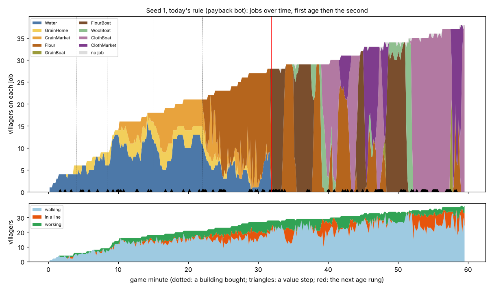
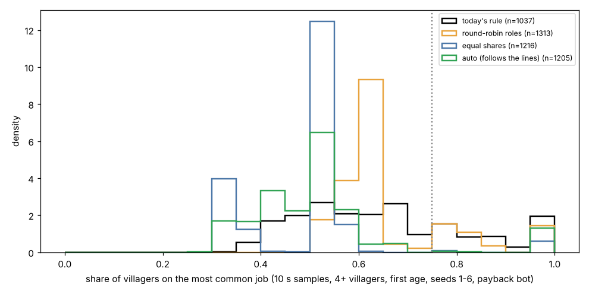
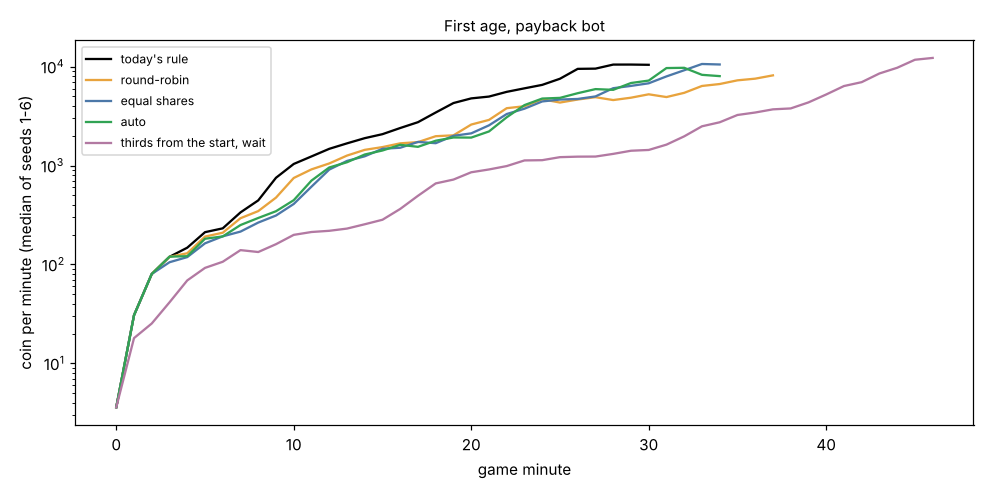
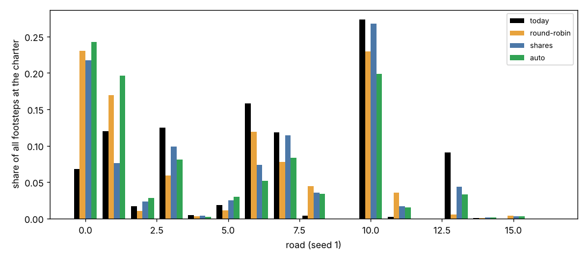
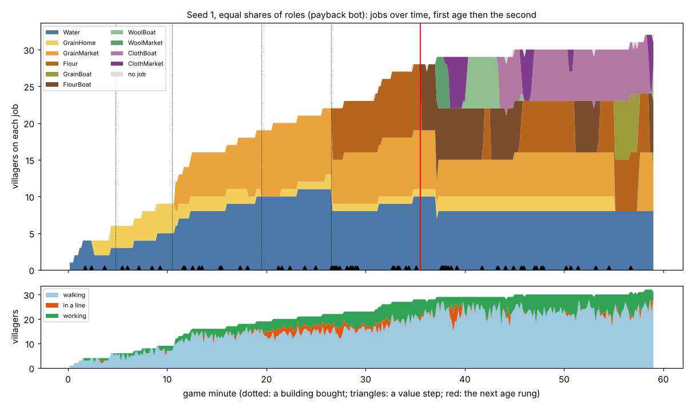

# Villager roles: what the villagers do today, what roles would do, and the design

Research for the lead, 2026-11-27. Branch `wt/n7-roles` (worktree `build/wt/n7-roles`), not for merging. All numbers come from the real
simulation (`sim/Town/`) played by the runner's bots; nothing here is guessed unless it says "by reading the code".

**In short.** Yes: villagers often all do the same job. With 4 or more villagers, more than three quarters are on one job **24 % of
the first age** and **63 % of the second age**, and the whole town is on one job for up to 5.4 minutes in the second age. The cause is the rule
itself: every villager takes the best-paying job independently. Only the expected wait pushes back, and that wait is blind in two places.
Every way of *assigning* roles that I tried makes the town poorer. Hard roles cost **+15 to +26 % on the charter minute** with the
payback bot (+11 to +19 % with cheapest-first), and up to **+55 to +60 %** when roles are set before their workplace exists and
villagers wait. No fixed split beats today's rule; the best split I found was still +15 %. Soft roles (a villager keeps its role unless another job pays
clearly more) close the gap: +0 % at 1.1x, +5 % at 1.25x, +11 % at 2x. That turns roles into a dial between "spread out" and "rich".

---

## How to reproduce

```
cd build/wt/n7-roles
dotnet build tools/TideToll.Tools -c Release
R="dotnet run --no-build --project tools/TideToll.Tools -c Release -- roles"
# part 1 and the main table of part 2 (first age, seeds 1-6, both bots):
$R --seeds 1-6 --policy off,rr,shares,auto --fallback wait --bot payback  --out OUT/m-payback  > OUT/m-payback.csv
$R --seeds 1-6 --policy thirds --fallback wait,best --bot payback --out OUT/m-payback | tail -n +2 >> OUT/m-payback.csv
#   (same two lines with --bot cheapest into OUT/m-cheapest)
# other splits:  $R --seeds 1-6 --policy shares --bot payback --weights 1,1,2   (water,grain,flour[,river])
# soft roles:    $R --seeds 1-6 --policy shares,rr --fallback prefer --prefer 1.25 --bot payback
# second age:    $R --seeds 1-3 --policy off,rr,shares,auto,thirds --fallback wait --bot payback --river --out OUT/r
# the wait fix:  $R --seeds 1-6 --policy off --bot payback --fixwait     (add --river for the second age)
python3 tools/roles-analysis.py     # reads the CSVs from the current directory (m-*, w.csv, p.csv, r.csv, r/, m-payback/), prints the tables, draws the plots
```

`roles` (`tools/TideToll.Tools/RolesCommand.cs`) plays each seed with the bot to the charter (and with `--river` it plays on to the seal, at most 120 minutes).
For each age it prints one CSV row. It writes a time series every 10 s (villagers by job, by phase, by role; line length at the well, fields and mill;
coin a minute; the active request and drive), the purchases, the roads at the charter and the spells. A whole first age takes about 0.4 s, so every
number below can be rerun in seconds. With roles off the branch plays exactly as `main`: `town --seeds 1-6 --bot payback` gives the
same charter minutes with and without the branch's changes (31.7, 30.3, 31.3, 30.7, 27.5, 29.5).

**The bots' own baseline.** The payback bot reaches the charter at **30.2 min** (27.5-31.7) with **186 purchases**. Cheapest-first
reaches it at **37.0 min** (36.2-38.5) with **205 purchases**. The game played by real input (33.9 min, 201 purchases) falls between the two, so
every comparison below is against the same bot with today's rule, and I report both bots for the main table.

---

## Part 1: what the villagers do today

### Where their time goes (first age, payback bot, seeds 1-6)

| seed | charter min | purchases | longest line | time some line > 0 | time > 75 % on one job | time 100 % on one job | spells > 75 % | longest spell (s) | decisions | ticks with 2+ deciding | pairs deciding together | same workplace | same job |
|---|---|---|---|---|---|---|---|---|---|---|---|---|---|
| 1 | 31.7 | 191 | 11 | 54 % | 31 % | 11 % | 22 | 87 | 3858 | 438 | 522 | 224 | 236 |
| 2 | 30.3 | 183 | 15 | 30 % | 18 % | 8 % | 10 | 86 | 3954 | 482 | 561 | 121 | 114 |
| 3 | 31.3 | 186 | 13 | 48 % | 19 % | 8 % | 22 | 70 | 3860 | 490 | 574 | 220 | 219 |
| 4 | 30.7 | 188 | 11 | 45 % | 33 % | 12 % | 44 | 103 | 3927 | 521 | 612 | 314 | 321 |
| 5 | 27.5 | 184 | 9 | 47 % | 28 % | 13 % | 23 | 97 | 3682 | 506 | 586 | 250 | 252 |
| 6 | 29.5 | 185 | 14 | 38 % | 15 % | 4 % | 6 | 100 | 3961 | 547 | 643 | 206 | 200 |

The shares of time count only seconds with 4 or more villagers. "Same job" counts the pairs that took the same `JobKind`.

- A villager's time: **73 % walking, 7 % in a line, 19 % working, 0 % idle** (means over villager-ticks). In the second age: 77 / 11 / 12 / 0.4 %.
  Waiting is not where the time goes. Walking is.
- Line lengths: the longest line at the mill is 6-12 villagers, at a field 3-11, at the well 2-4.



The plot shows seed 1, first age then the second (red line). Up to minute 4 the only workplace is the well, so all water is no choice at all.
From minute 4 to 22, water keeps 50-80 % of the town even with the fields open. After the mill opens (about minute 22), flour climbs to 80-100 %.
In the second age the whole town swings from one boat job to the next as solid blocks (FlourBoat, then ClothBoat 100 % for 5.4 min).



### The spells (more than 3/4 on one job, 4+ villagers)

First age, seeds 1-6:

| job | when | spells | seconds in all | longest (s) |
|---|---|---|---|---|
| Water | with the field open | 40 | 832 | 103 |
| Water | before the field (only the well exists) | 21 | 785 | 86 |
| Flour | after the mill | 58 | 552 | 49 |
| GrainMarket | | 8 | 343 | 100 |

Second age, seeds 1-3 (today's rule, 63 % of the age above 3/4 on one job, often 100 %):

| job | spells | seconds in all | longest (s) |
|---|---|---|---|
| ClothBoat | 12 | 942 | 326 |
| FlourBoat | 10 | 596 | 158 |
| WoolBoat | 6 | 377 | 131 |
| GrainBoat | 5 | 323 | 158 |
| Flour | 20 | 271 | 83 |
| ClothMarket | 7 | 113 | 25 |

### Do purchases flip the town?

The table shows how much of the town changes job in the 30 s after an event. The measure is half the L1 distance between the job mixes, with 6 or more villagers
(payback, seeds 1-6, first age):

| event | times | mean change | largest |
|---|---|---|---|
| any 30 s window (background) | 928 | 14 % | 93 % |
| the charter drive starts | 6 | 20 % | 70 % |
| Load step | 18 | 17 % | 74 % |
| a villager arrives | 132 | 17 % | 74 % |
| a value (price) step | 226 | 16 % | **93 %** |
| a building | 24 | 15 % | 68 % |
| a request for grain starts | 30 | 15 % | 58 % |
| a request for water starts | 35 | 14 % | 38 % |
| Tools / bell track / extend / regulars / pave / hand / pace | | 10-14 % | 24-74 % |

On average a purchase moves the town only a little more than the background churn. But a single price step can send 93 % of the
town to another job within 30 s, and the drive (+25 % on one good) moves a fifth of it on average. The town does not flip mostly because of
upgrades. It flips because of the structure of the rule, described below.

### Why the rule does it

1. **Every villager maximises its own coin per second, and jobs differ a lot in value.** Today's rule (`ChooseJob`, `TownJobs.cs`) takes the
   job with the highest `load x value / (walk + expected wait + work + walk)`. The only thing that pushes back on a crowded job is the expected wait.
   The well's line stays short (2-4), so water keeps winning for everyone until the line costs more than the walk to the field. Flour, once the
   mill stands, pays so much more that it is worth a long wait. The rule settles where every job pays the same *at the margin*. With
   one job far ahead, that settling point is "nearly everyone on it". In economics this is the expected answer of a greedy rule, not a bug, and it is why the
   rule earns well. Every role system below is poorer for the same reason.
2. **The flour wait is blind (by reading the code, confirmed by the experiment below).** `ExpectedWait(mill)` counts the villagers working
   and queued at the mill and those *walking to the mill*. A villager who has chosen Flour walks to a *field* first (its `Workplace` is the field),
   so every flour picker still on the way to the field or working it is invisible to the mill's wait. Ten villagers can choose flour within a
   few seconds and each sees an empty mill. The mill line then reaches 6-12.
3. **The second-age sites are blinder still.** `SiteWait` (`TownRiverJobs.cs`) counts only villagers *queued at* the pasture or weaver, not
   those walking there, so all of them pick wool or cloth together. Boat jobs check only that the boat still wants goods (`BoatNeed`), and
   the boats want a lot. This is where the town goes 100 % one job for minutes.
4. **Deciding in the same tick is not the cause.** About 12-14 % of the ticks with a decision have two or more villagers deciding. In those ticks,
   40 % of the pairs pick the same workplace. That is natural with one well and one or two fields. `ExpectedWait` does see a villager who
   decided earlier in the same tick: `SetRoute` sets its `Workplace` and puts it in `Walking` before the next villager in the array steps, and a villager
   who is already at the node queues at once (`QueueLen`). The order is fixed (by villager id), so it is deterministic.

**The experiment: count the blind ones** (`--fixwait`: the mill's wait also counts flour pickers on their way to the field, and the
pasture's and weaver's waits count walkers bound there). This is today's rule with a correct count, and no roles:

| | first age charter (min) | first age > 75 % on one job | second age > 75 % on one job (seeds 1-3) | second age coin/min (seeds 1-3) |
|---|---|---|---|---|
| today | 30.2 | 24 % | 63 % (72, 51, 66) | 76k, 38k, 28k |
| wait counted right | **29.7** (-1.7 %) | 20 % | **42 %** (56, 32, 39) | 59k, 37k, 25k |

Counting correctly takes a third of the herding out of the second age and costs nothing in the first. It does not remove the herding:
cause 1 remains.

---

## Part 2: what roles would do

### The switch (on the branch)

- `VillagerState.Role` (int; 0 = Any, then Water, Grain, Flour, River). `Town.RoleOf(JobKind)` maps each job to a role: Water to Water;
  GrainHome, GrainMarket and GrainBoat to Grain; Flour and FlourBoat to Flour; Wool and Cloth jobs to River.
- `ChooseJob` becomes a wrapper (`sim/Town/TownRoles.cs`) around today's choice (`ChooseJobCore`). While a role is set, `Consider` and
  `RConsider` skip every job of another role. Fallbacks:
  - **wait**: the role has nothing, so the villager stays idle and tries again next tick;
  - **best**: the role has nothing, so the villager takes the best job of any role;
  - **prefer x**: the villager weighs both without committing and leaves its role only when another job pays more than x times its role's best.
- How roles are given (`Town.RoleMode`, applied at the top of `Step`):
  1. `rr` round-robin: once, as each villager arrives, from the roles whose workplace exists at that moment;
  2. `shares`: equal (or `--weights`) shares by villager number over the roles that exist now, rebalanced when a role appears (the mill);
  3. `auto`: starts as equal shares; every 10 s it moves one villager from the role with the most villagers waiting (in a line, or idle) to a role with nobody waiting;
  4. `thirds`: a third water, a third grain, a third flour **from the start** (the river's quarter in the second age), whether the workplace exists or not;
  5. `off`: today's rule.

Note: with `rr`, `shares` and `auto`, "wait" and "best" gave identical runs, because those modes only give roles that have a workplace,
so a role never runs out of work. The fallback matters only when roles can exist before their workplace (`thirds`) or a workplace can close.

### Against today's rule: first age, seeds 1-6

Payback bot (today: 30.2 min, 186 purchases):

| policy | charter min (mean, range) | vs today | purchases | coin/min over the age | walking | in a line | working | idle | > 75 % on one job | longest spell (s) | worn-in roads (of 17) | roads walked (effective) | top-3 roads' share of steps |
|---|---|---|---|---|---|---|---|---|---|---|---|---|---|
| today | 30.2 (27.5-31.7) | | 186 | 3770 | 73 % | 7.1 % | 19 % | 0.0 % | 24 % | 103 | 11.2 | 6.7 | 64 % |
| round-robin | 37.9 (36.2-39.4) | **+26 %** | 197 | 3047 | 75 % | 6.7 % | 18 % | 0.0 % | 17 % | 366 | 13.7 | 7.7 | 61 % |
| equal shares | 35.2 (34.2-35.8) | **+17 %** | 197 | 3221 | 76 % | 4.3 % | 19 % | 0.0 % | 3 % | 63 | 13.8 | 8.2 | 60 % |
| auto (follows the lines) | 34.9 (32.9-37.6) | **+16 %** | 195 | 3155 | 79 % | 2.9 % | 18 % | 0.0 % | 7 % | 177 | 13.7 | 8.3 | 59 % |
| thirds from the start, wait | 46.9 (46.1-47.7) | **+55 %** | 212 | 2421 | 61 % | 1.8 % | 14 % | 23.4 % | 0 % | 0 | 13.7 | 7.1 | 68 % |
| thirds from the start, best | 34.7 (32.7-37.1) | **+15 %** | 195 | 3330 | 76 % | 4.4 % | 20 % | 0.0 % | 3 % | 69 | 13.7 | 7.8 | 63 % |

Cheapest-first bot (today: 37.0 min, 205 purchases):

| policy | charter min | vs today | purchases | coin/min | in a line | idle | > 75 % on one job | worn-in roads | roads walked (effective) |
|---|---|---|---|---|---|---|---|---|---|
| today | 37.0 (36.2-38.5) | | 205 | 2682 | 6.0 % | 0 % | 16 % | 11.3 | 7.2 |
| round-robin | 42.6 (40.9-44.1) | +15 % | 210 | 2406 | 5.7 % | 0 % | 17 % | 12.7 | 7.8 |
| equal shares | 42.5 (41.3-43.4) | +15 % | 213 | 2384 | 3.8 % | 0 % | 2 % | 13.7 | 8.5 |
| auto | 43.9 (42.3-46.1) | +19 % | 212 | 2306 | 2.5 % | 0 % | 6 % | 13.5 | 8.7 |
| thirds, wait | 59.4 (4 of 6 seeds; 2 never within 60 min) | **+60 % or more** | 223 | 1702 | 1.3 % | 30 % | 0 % | 13.7 | 7.4 |
| thirds, best | 41.1 (39.5-42.6) | +11 % | 212 | 2508 | 3.9 % | 0 % | 2 % | 13.7 | 8.1 |

Can a careful player find a split that matches today? Equal shares with other weights (water, grain, flour), payback, seeds 1-6:

| weights | 1,1,1 | 1,1,2 | 1,1,3 | 1,1,4 | 1,2,3 | 1,2,4 | 2,1,3 |
|---|---|---|---|---|---|---|---|
| charter min | 35.2 | 34.9 | 35.1 | **34.8** | 35.6 | 35.6 | 34.9 |

**No fixed split comes within 15 % of today's rule.** The best mix changes all the time (prices, requests, the drive, new
villagers, the mill), and a fixed split cannot follow it. The "auto" rule follows the lines, not the money, so it is no better.

Soft roles (fallback "prefer": leave the role for a job paying more than x times the role's best), payback, seeds 1-6:

| x | equal shares: charter min | vs today | > 75 % on one job | round-robin: charter min | vs today |
|---|---|---|---|---|---|
| 1.1 | 30.0 | -1 % | 23 % | 30.9 | +2 % |
| 1.25 | 31.6 | +5 % | 20 % | 30.9 | +2 % |
| 1.5 | 32.4 | +7 % | 15 % | 31.6 | +5 % |
| 2 | 33.6 | +11 % | 8 % | 34.5 | +14 % |

Soft roles buy back the income, and with it they buy back the herding. Spreading the town and keeping it rich pull against each other,
and the factor x sets the trade between them.



### The second age (seeds 1-3, payback, rung at the charter and played to the seal)

| policy | seal (min after the ring) | purchases | coin/min | in a line | > 75 % on one job | longest spell (s) | roads walked (effective) |
|---|---|---|---|---|---|---|---|
| today | 25.3 (23.0-28.0) | 198 | 47 103 | 11.1 % | 63 % | 326 | 6.6 |
| round-robin | 18.5 | 76 | 10 628 (**-77 %**) | 10.6 % | 0 % | 0 | 8.0 |
| equal shares | 23.5 | 140 | 24 587 (**-48 %**) | 3.2 % | 0 % | 0 | 8.0 |
| auto | 24.0 | 139 | 24 285 (-48 %) | 2.2 % | 0 % | 0 | 8.5 |
| thirds (and a river quarter) | 22.9 | 132 | 23 448 (-50 %) | 2.8 % | 0 % | 0 | 7.8 |
| shares, prefer 1.25 | 24.8 | 199 | 45 211 (-4 %) | 10.0 % | 50 % | 134 | 6.9 |
| auto, prefer 1.25 | 25.6 | 216 | 54 154 (+15 %) | 9.1 % | 55 % | 214 | 7.2 |

**Warning about the seal minute.** The second age's level thresholds scale with the town's best coin a minute (`RiverLevelRenown`:
`LevelRate = max(..., S.MaxCoinPerMinute)`). A poorer town therefore has *lower* thresholds and reaches the seal *sooner*. Round-robin
"wins" the seal in 18.5 min while earning 77 % less. In the second age, compare coin a minute, not the seal minute. The adaptive thresholds hide
how much poorer hard roles make the town. A real roles system needs this checked: would a careless role setup be rewarded with a shorter age?

Round-robin collapses in the second age because roles are given once, on arrival. The first-age villagers never take the river's jobs,
and only newcomers get the river role.

### The roads: do roles make the map more varied?

Yes, a little and consistently. With hard roles **13.7-13.8 of the 17 open roads wear in by the charter instead of 11.2**, footsteps spread over
**8.2 effective roads instead of 6.7** (the exponential of the entropy of footsteps per road), and the three busiest roads carry 59-61 % of the
steps instead of 64 %. The water and grain villagers keep walking their own roads while today's town would all be on the mill road.
Part of the extra wear comes from the longer age (roles take 5-8 minutes longer to reach the charter, so there are more footsteps). Soft roles
at 1.1-1.25x fall back to today's pattern (11.3-11.7 worn in, 6.8-7.3 effective).




### What this means for the design (plainly)

- **Every hard role system makes the town poorer than today's rule**: +15 % to +26 % on the charter minute for a sensible
  assignment, about 15-20 % less coin a minute in the first age and about half the coin a minute in the second.
- **A careless player is punished hard**: roles set before the mill (thirds, wait) cost **+55 to +60 %**, with 23-30 % of the villagers
  idle. Round-robin in the second age earns **77 % less**.
- **A careful player cannot beat today's rule.** The best fixed split is still +15 %. The game's automatic rule *is* the careful
  player, so playing roles well only ever gets back towards what the town does by itself now. In design terms, the roles would be a tax.
- Roles do what the owner asked for on screen: herding drops from 24 % to 3 % (first age) and from 63 % to 0 % (second age), lines get
  shorter, and the map wears in more widely.
- To make roles worth choosing, the rules must give them a reason: something only a role-held villager gets (skill that grows with time
  in a role, a bonus for a full crew at a workplace, a cost to switching jobs), or prices retuned. Without such a reason, roles can only cost the player.

---

## Part 3: technical design for roles in the simulation

### Decisions that change the cost of everything else

1. **Hard or soft roles.** A hard role (`ChooseJob` sees only the role's jobs) is simple and readable, but it costs 15-26 % on pacing and needs
   retuning of both ages (pacing tests, adaptive river thresholds). A soft role ("prefer x") keeps today's pacing within 0-11 % but herds
   again as x goes down. The owner must pick the spot on that dial, or pick a reward that makes hard roles pay (decision 3).
2. **Who sets roles: the player per villager, the player as counts per role, or the town automatically.** Per-villager roles need
   selection, a villager panel, a save field per villager, and a story for newcomers. Counts per role ("3 on water, 4 on grain") need only five
   integers in the save and one shop-like control, and the simulation picks the villagers. An automatic mode is required either way for a player who
   does not care. That mode must default to today's rule (Role Any), or the careless player loses 15-60 %.
3. **Whether roles carry a gain.** If a role gives nothing, roles are a pure tax (Part 2). With a gain (for example +x % work speed after N seconds in
   the role, or a "full crew" bonus), the rules change, which means pacing retuning, new `Worth` estimates for the bots, and new achievements. That is
   the largest piece of work, and the owner should decide it before anything is built.

Fixing the two blind waits (Part 1, cause 2 and 3) is independent of roles and cheap. It should be done first, because it removes
a third of the worst second-age herding at no cost in income.

### Data

```csharp
public enum VillagerRole : byte { Any = 0, Water = 1, Grain = 2, Flour = 3, Wool = 4, Cloth = 5 }   // appended only; Any = today's rule

public sealed class VillagerState { ... public VillagerRole Role; }      // Any for every old villager and every newcomer in auto mode
public sealed class TownState
{
    ...
    public int[] RoleWant = new int[6];          // counts mode: villagers the player wants in each role (0 = no wish)
    public RoleMode Roles = RoleMode.Auto;       // Auto = today's rule; Counts = RoleWant applies; Manual = per-villager
    public double RolePrefer = 1.25;             // soft roles: leave the role for a job paying more than this times the role's best (decision 1)
}
```

- `RoleOf(JobKind)` is a static table (a `byte[]` indexed by `JobKind`), so river jobs map in one place. Splitting the river role into Wool
  and Cloth matches the two sites, and the jobs already split that way.
- Counts mode: at most one rebalance per second (as `StepCrowding`). It changes the role of the fewest villagers needed, picking the lowest-id
  villagers whose current trip is idle or about to end. The rebalance must not depend on dictionary order.

### Where the rules change

- `ChooseJob` (`TownJobs.cs`): becomes the wrapper on the branch (`TownRoles.cs`). Core choice unchanged, role filter in `Consider`/`RConsider`,
  fallback after. Keep the filter a field (`_roleFilter`), not a lambda (hot path).
- The river jobs (`TownRiverJobs.cs`, `ConsiderRiver`, `StartRiverJob`): same filter in `RConsider`. `BoatNeed` and `SiteWait` stay as they are,
  except for the wait fix.
- `ExpectedWait` / `SiteWait`: count the committed villagers, including those bound for the mill through a field and those walking to a site.
  This is the `--fixwait` change.
- **Extra hands** (`TownDrive.cs`, `StepHands`): a hand is offered when a line stays long. With hard roles a line means "too many in this role", not
  "too few places". Decide whether the hand offer looks at lines (as now) or at idle villagers in the role. Otherwise counts mode creates lines
  and then sells hands to cure them.
- **The bell**: it speeds walking and work for everyone, and roles do not change it. If roles are hard, ringing with a role that has no work is
  wasted, which is fine. No code change is needed.
- **Requests and the drive**: today they pull the whole town to one good (+50 % / +25 %). With hard roles only that role's villagers answer,
  so requests are met less often. `ReqScale` adapts to misses, so requests get smaller, which is a quiet pacing change. Hint text could say
  "put more on Flour for the request".
- **Second-age thresholds** (`RiverLevelRenown`): they scale with `MaxCoinPerMinute`. Check that a role setup cannot shorten the age by
  earning less (Part 2).

### What the game asks and tells (in the style of `docs/plans/town-sim-api.md`)

Views:

```csharp
VillagerView.Role                      // VillagerRole (Any in auto)
town.Roles                             // RoleMode
town.RoleInfo(VillagerRole r)          // struct RoleView { Open (a workplace exists), Want, Have, Working, Queued, Idle, BestRate (coin/s the role pays now) }
town.RoleOfJob(JobKind j)              // for drawing
```

Player actions (return true if they happened; each emits an event):

```csharp
town.SetRoleMode(RoleMode m)           // Auto | Counts | Manual
town.SetRoleWant(VillagerRole r, int n)// counts mode; clamped so the sum <= villagers
town.SetVillagerRole(int id, VillagerRole r)  // manual mode
```

Events: `TownEventKind.RoleChanged` (Villager, Index = new role), appended to the enum. Optionally `RoleIdle` the first time in a spell that a
role has villagers and no work, which gives the hint line its "Flour has no mill yet" text.

### Determinism and allocation

- Same seed and the same `SetRole*` calls at the same ticks give the same run. Calls apply at the next `Step` in call order. Rebalancing iterates
  `S.Villagers` by index. No sets or dictionaries.
- No allocation in the tick: role counts are scratch `int[6]`, already pre-sized (as on the branch: `_avail`, `_roleWait`, `_roleCount`).
  `InvariantTests.TickAndStatsAllocateNothing` must run with roles on, in counts mode with a rebalance inside the measured window.

### Save format and migration

- New fields `VillagerState.Role`, `TownState.Roles`, `RoleWant`, `RolePrefer`. A missing field in an old save deserialises to its default:
  **Role Any and mode Auto, which is exactly today's rule**. Version stays 2/3 if the defaults are safe (as the Regulars and green-pass fields did);
  otherwise go to 4 and accept 2, 3 and 4.
- Migration test: load a saved v2 and a saved v3 town (both recorded before the change, kept as test data). Check that every villager is `Any`, that the mode is
  Auto, and that 5 minutes of play are tick-for-tick identical to the same save run on the old code (store the expected hash with the test data).
  Round trip: `SaveRoundTripContinuesExactly` with a town in counts mode and a manual villager.

### Tests that pin today's behaviour, and what replaces them

- **Kept as they are, with roles in Auto:** every pacing test (`TownPacingTests`: charter in time, purchases keep coming, nothing affordable,
  requests met half to four fifths; `TownRiverPacingTests`: 20-35 min, two purchases a minute, landing third, crossings),
  `SameSeedSameActionsSameTown`, `SaveRoundTripContinuesExactly`, `VillagersStayOnRoadsAndNeverGetStuck`,
  `TownRulesV2Tests` (job values, the queue rule `Busy >= Places when queued`). Auto must stay bit-identical to today, which is how
  this branch was checked (`town --seeds 1-6` unchanged).
- **The wait fix changes results** (charter 30.2 to 29.7 min with payback): the pacing tests still pass on their bands. Any recorded trace that
  includes villager jobs would need regenerating (none found in `sim.tests/Town`).
- **New tests:** a villager with a role never takes another role's job (hard) or does so only above the factor (soft); counts mode reaches the
  wanted counts within N seconds and never changes more than needed; wait/best fallback when a role has no workplace; the herding measure
  as a target ("share of time > 75 % on one job, 4+ villagers" below a band in Auto after the wait fix, and in Counts mode); roles on
  with no allocation.

### What the bots need

- The bots play Auto by default (their pacing is today's). Add one bot option `Roles = Counts` with a simple rule. The useful one is "set the counts
  to the current split of jobs the Auto rule would choose, every 60 s", which is the careful player. Add a second, "equal shares", for the careless
  player. Those two give the pacing band that roles must stay in, as in Part 2.
- `TownBot.Gain`/`WorthAt` estimates would need to know that a hand or a value step helps only the villagers in that role.

### Cost per tick

- Measured on the branch: no difference I could measure. A whole first age runs in about 0.4 s with or without roles, and seeds 1-3 played
  through both ages take 2.1-2.8 s of wall time in all modes, including the runner's own per-tick reading of every villager.
- By the code: a decision is O(workplaces x villagers) because of `ExpectedWait`. There are about 2 decisions per game second, so a hard
  role filter costs nothing. A soft role runs the choice three times (role best, overall best, then the real choice), and the counts
  rebalance is O(villagers) once a second. The real cost is in `ExpectedWait`'s scan of every villager per workplace (the wait fix adds a condition
  in the same loop). If villager counts grow far past 40, keep a per-workplace "committed" counter instead of scanning.

---

## Files

- Branch `wt/n7-roles`: `sim/Town/TownRoles.cs` (roles, modes, fallbacks, decision counters), small hooks in `TownJobs.cs`,
  `TownRiverJobs.cs`, `Town.cs`, `TownState.cs`; `tools/TideToll.Tools/RolesCommand.cs` (`roles` command); `tools/roles-analysis.py`.
- Plots: `docs/plans/n7/research/plots/` (`jobs-seed1-today.png`, `jobs-seed1-shares.png`, `share-most-common-job.png`,
  `coin-per-minute.png`, `roads-seed1.png`).
